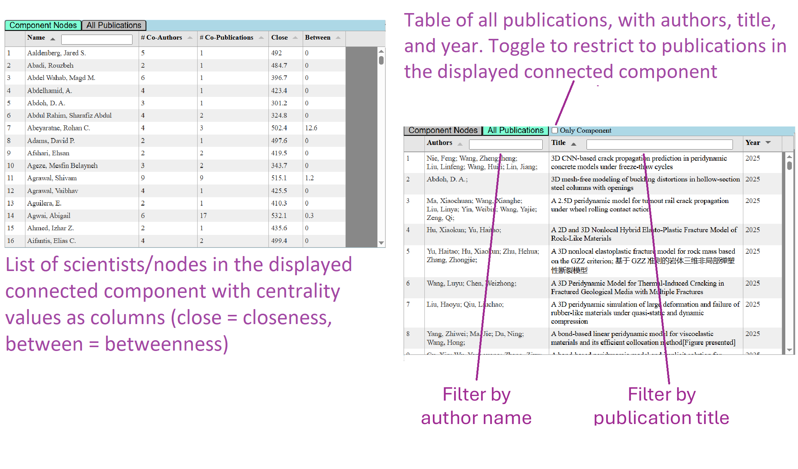
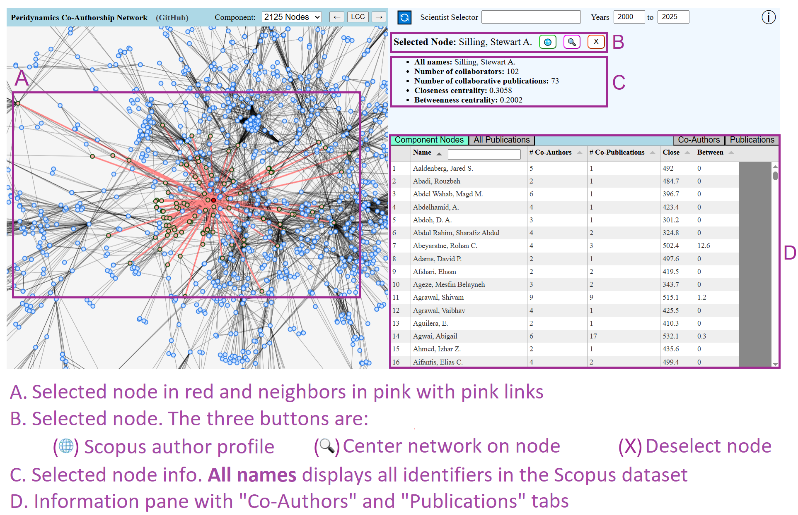
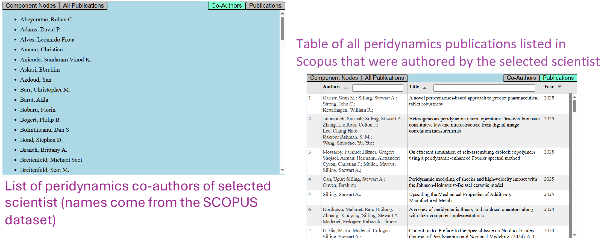

[^doe]: This manuscript has been authored in part by UT-Battelle, LLC, under contract DE-AC05-00OR22725 with the US Department of Energy (DOE). The US government retains and the publisher, by accepting the article for publication, acknowledges that the US government retains a nonexclusive, paid-up, irrevocable, worldwide license to publish or reproduce the published form of this manuscript, or allow others to do so, for US government purposes. DOE will provide public access to these results of federally sponsored research in accordance with the DOE Public Access Plan (http://energy.gov/downloads/doe-public-access-plan).

# Summary
PDnetwork is an interactive co-authorship network visualization tool in the field of peridynamics, a nonlocal formulation of continuum mechanics designed to model material damage and failure. For each year from 2000 to 2025, a network is constructed whose nodes represent authors of peridynamics publications and whose links connect two authors if they co-authored a peridynamics publication listed in Scopus [@scopus], with link weights representing the frequency of collaborations. The visualization tool provides many insights into the structure and evolution of the peridynamics community. 

# Statement of need
The field of peridynamics grew from a single paper published in 2000 by Stewart Silling [@silling2000reformulation] to encompass over 3200 publications and 3900 authors by 2025. Given that peridynamics is a relatively new field, analyzing its growth may provide insights into how new communities in specialized scientific fields develop from a single publication. The target audience of this work is primarily peridynamics scientists and researchers in scientometrics who are interested in the rapid evolution of the field of peridynamics. However, this work would also be of interest to researchers with an interest in the evolution of emerging fields, as expressed through co-authorship. To the best of the authors' knowledge, this is the first tool of its kind in the field of peridynamics.

# State of the field
An analysis of the growth of the peridynamics co-authorship network up to 2019 was published [@dahal2023evolution], but the publication is a static document that does not provide user interactivity. In addition, the field has grown considerably since 2019, so an updated analysis was performed up to 2024 [@dahal2026evolution]. This follow-on analysis revealed deviations from previous trends, suggesting that trends may evolve over time.

Open-source tools for visualizing networks include Gephi [@bastian2009gephi] and Cytoscape [@shannon2003cytoscape], but they do not provide peridynamics co-authorship data, and their general applicability to networks can make it challenging for new users to adapt the tool to specifically study the collaboration structure of a specific field such as peridynamics.

# Software design
PDnetwork is a single-page web application that uses SigmaJS [@sigmajs2026] for the network visualization and Graphology [@plique2021graphology] for network statistics. This paper describes version 1.1.1 of PDnetwork [@zenodopdnetwork]. The main page is a tableau that allows users to visualize the network, examine network and node metrics, and explore the publication list used to construct the network. All of the network metrics were precomputed using Python and the NetworkX library [@hagberg2008exploring], and then the collection of computed metrics and data was saved to a source file that is loaded by the web page. Since the metrics are precomputed, the loading of the web page is much faster than if the metrics had to be computed client-side by the user.

The bibliometric data used to build PDnetwork is provided in obfuscated form in the repository; we cannot post the raw data as a downloadable file due to permission restrictions from Scopus. The obfuscated data file is generated by running scripts in the software on data downloaded from Scopus, and the data is decoded when displayed by the browser.

# Research impact statement
Many peridynamics researchers have already found value in the analyses of the peridynamics co-authorship network from 2000 to 2019 [@dahal2023evolution] and from 2000 to 2024 [@dahal2026evolution], as evidenced by the citation and access counts listed on the webpages for those publications. The insights of those papers were aided by interaction with the PDnetwork software, which is referenced in the latter publication [@dahal2026evolution]. Providing an interactive and up-to-date version of the peridynamics co-authorship network will increase its usefulness significantly. 

# Tool demonstration
We now show selected screenshots of the tool in use, highlighting its main features. First, we annotate all panels of the PDnetwork interface in \autoref{fig:interface} in its default view. While the network has multiple connected components, the PDnetwork interface displays only one connected component at a time, and the user can change the displayed component (with the largest connected component (LCC) set as the default, as shown in \autoref{fig:interface}).

{width=85%}

In the default view, the information pane has two tabs: **Component Nodes** and **All Publications**. We show these tabs in \autoref{fig:selected}. Note that the "All Publications" tab has a toggle for whether to filter the list of publications to only those in the currently displayed connected component.  

{width=85%}

Users can select an author (also referred to as scientist in PDnetwork) by clicking on the corresponding node in the network (Panel G in \autoref{fig:interface}), clicking on the name in the information pane (Panel I in \autoref{fig:interface}),  or using the Scientist Selector search field (Panel D in \autoref{fig:interface}). After selecting an author, the content displayed in PDnetwork is updated to show information about the author. \autoref{fig:selectedview} illustrates the updated interface, using the selection of "Silling, Stewart A." as an example. The component and network information (Panel H in \autoref{fig:interface}) is replaced with information about the node representing the selected author (see Panels B and C in \autoref{fig:selectedview}), and the selected node and its neighbors are highlighted in the network (see Panel A in \autoref{fig:selectedview}).

{width=85%}

When a node is selected, the information pane gets two new tabs, which we detail in \autoref{fig:infoselected}. The **Co-Authors** and **Publications** tabs both apply to the selected author.

{width=85%}

# AI usage disclosure
The first few years of development of this codebase was done without usage of AI. Various Claude Opus models (up to version 5.5) were used in the last stages of the development to implement performance improvements, minor features, and data obfuscation. Claude Opus was also used to create and verify the compilation of the paper to the specified JOSS format.

# Acknowledgements
B. Dahal was supported by the U.S. Department of Energy, Office of Science, Office of Workforce Development for Teachers and Scientists (WDTS) under the Science Undergraduate Laboratory Internship program. P. Seleson was supported by the Laboratory Directed Research and Development Program of Oak Ridge National Laboratory, managed by UT-Battelle, LLC, for the U.S. Department of Energy.

# References